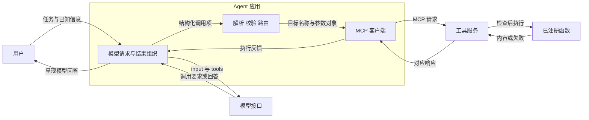
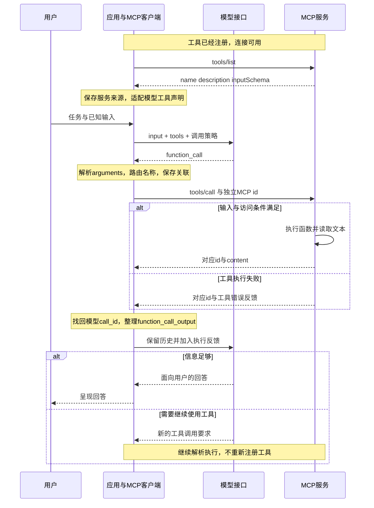

# Agent 工具调用：从工具声明到执行反馈

> 适用范围：应用使用 OpenAI Responses 的自定义 function 工具，并自行通过 MCP 客户端连接工具服务。MCP 字段参照 2025-06-18 规范。以下是单次调用的教学推演，不是实时抓包；平台托管工具和其他模型接口可能采用不同封装。

**核心问题：模型给出工具名称和参数之后，程序怎样执行，并让模型利用结果回答用户？**

模型产生结构化调用要求；应用解析、路由并组织执行；工具服务检查输入和访问条件，产生结果；应用把对应反馈加入后续模型输入，模型再生成答复。理解它需要始终区分三个对象：**工具规则、本次参数值、执行产生的结果**。

## 1. 先确定要完成什么

用一个文件读取接口跟踪技术过程。任务中的已知输入是逻辑路径 `/workspace/notes.txt`，希望取得文件开头 20 行。假设服务已注册 `read_text_file`，且应用已建立可用连接。这些都是教学条件，不表示读者电脑上存在该路径。

成功需要同时满足三件事：服务确实取得允许读取的文本；执行反馈对应回原来的模型调用；模型获得反馈后组织答复，应用把它呈现给用户。仅生成一个看起来正确的 JSON，尚未满足其中任何一个执行条件。

## 2. 为什么还需要应用和协议

模型接口返回的名称和参数首先是一份数据。要读文件，还需要知道哪个实现接收它、输入是否有效、路径是否允许访问，以及调用失败时怎样返回错误。

最直接的实现是应用直接调用本地函数，或调用封装外部 API 的代码。若工具由独立服务提供，应用和服务还需要共同约定发现、调用和响应的格式；MCP 承担这一段通信。它不替代模型生成调用要求的机制，也不等于读取文件的代码。

| 概念                            | 回答的问题                 | 本例中的对应                             |
| ------------------------------- | -------------------------- | ---------------------------------------- |
| 工具能力                        | 能做什么                   | 读取文本文件                             |
| Function Calling / Tool Calling | 模型如何提出调用要求       | 生成工具名和参数值                       |
| MCP                             | 应用怎样与工具服务交换信息 | `tools/list`、`tools/call`、响应         |
| 应用                            | 谁把各段组织成闭环         | 准备输入、解析、路由、配对、再次请求模型 |

直接接入、MCP 接入、平台内置是理解接入方式的几个入口，彼此并非互斥且穷尽的分类；同一种能力可以通过不同方式提供。

## 3. 用相同的值走完最小推演

| 步骤     | 输入                         | 变化                         | 保持不变的内容                    |
| -------- | ---------------------------- | ---------------------------- | --------------------------------- |
| 声明     | `path:string`、`head:number` | 告知用法及格式               | 尚无本次具体值                    |
| 生成调用 | 任务已知路径和 20 行         | 另生成 `name` 与 `arguments` | 原来的规则继续保留                |
| 解析     | JSON 文本                    | 变成可按键取值的对象         | 路径仍为原路径，行数仍为 20       |
| 包装请求 | 参数对象及目标工具名         | 进入 MCP 的 `params`         | 工具输入值不变                    |
| 执行     | `path`、`head`               | 检查后读出新内容             | 路径/行数仍是输入；原文件不被改写 |
| 返回     | 文件文本或失败说明           | 包装成模型工具反馈           | 反馈仍来自同一次执行              |

把 `head` 从 20 改成 5，会改变请求值及期望读取范围；不会把参数规则中的 `number` 改成 `5`。如果只是把 JSON 文本解析成对象，却没有调用处理函数，读取次数仍然为零。

## 4. 谁负责什么



**图 4-1｜应用连接模型与工具服务。** MCP 客户端在应用内。模型接口与服务的消息分别由应用处理；图中的往返关系不表示请求一出现就获得了访问权限。

开发者负责关联工具说明和执行函数。模型参考任务和说明生成选择及参数。应用或 SDK 负责解析封装、记录来源、关联请求和反馈。服务检查实际输入与运行权限并执行；最终用户答复由模型生成、应用呈现。

## 5. 一次完整调用的先后顺序



**图 5-1｜单次工具调用的闭环。** 为解释主体路径省略并行调用、连接初始化和传输细节。继续调用不是无限循环的保证；实际应用还需要自己的完成、失败或中止条件。

协议层错误与工具执行错误要区分。前者可使用协议错误响应；后者可以在工具结果中通过 `isError` 表达。不能把失败反馈转换为“已经读取成功”。

## 6. 看清字段和它们所属的对象

### 工具声明是规则

MCP 的 `name` 标识工具，`description` 描述用途，`inputSchema` 约束输入。规则中的 `properties` 列出属性，`type` 规定类型，`required` 列出必填属性。

本例工具的 `path` 是字符串，`head` 是可选的数字参数；完整参考接口还支持可选的 `tail`，且 `head` 与 `tail` 不能同时使用。本例只跟踪前两个字段。

应用适配到 Responses 时，在 `tools` 中放入 `type: "function"`、名称、用途和 `parameters`。这里的 `parameters` 仍然是规则。接口支持的 JSON Schema 范围及严格模式要求需要兼容处理，不能对所有服务的 schema 盲目复制。

`type: "function"` 描述工具类别，规则内的 `type: "string"` 描述参数类型；它们位于不同层级。`tool_choice: "required"` 要求模型调用工具，而 schema 的 `required: ["path"]` 要求调用输入包含路径，也不是同一个约束。

### 模型生成的是新的调用数据

以下片段表示 Responses 调用项的关键字段：

```json
{
  "type": "function_call",
  "name": "fs__read_text_file",
  "arguments": "{\"path\":\"/workspace/notes.txt\",\"head\":20}",
  "call_id": "call_demo_1"
}
```

`arguments` 在这里是 JSON 文本。应用先解析它，才能按 `path` 和 `head` 取值。`fs__` 是此教学应用选择的别名前缀，用于区分不同服务的入口；MCP 不规定所有工具必须使用这个前缀。应用使用已有映射找到文件服务与原始名称 `read_text_file`。

具体参数值必须有任务或已有信息作为依据。规则说明“路径是字符串”，不会自动提供模型尚不知道的路径。必要信息缺失时应补充获取或询问；这是一项正确处理要求，不是模型永不猜错的保证。

### MCP 请求把参数对象送给服务

```json
{
  "jsonrpc": "2.0",
  "id": "rpc_demo_41",
  "method": "tools/call",
  "params": {
    "name": "read_text_file",
    "arguments": {"path": "/workspace/notes.txt", "head": 20}
  }
}
```

`params` 是请求参数容器，里面的 `arguments` 才是工具输入对象。路径与行数没有改变。服务根据名称找到处理函数，验证输入、检查访问范围，然后读取。

模型的 `call_id` 与 MCP 的 `id` 属于两个关联域。应用要保留“哪次模型调用对应哪次服务请求”的关系；可以通过任务对象或 SDK 调用上下文管理，不要求一定建立全局映射表，更不要求编号取相同字符串。

### 执行结果是新增数据

MCP 响应带对应的 `id`，结果可放在 `result.content`，也可提供 `structuredContent`。应用取得反馈后，整理模型可接收的形式：

```json
{
  "type": "function_call_output",
  "call_id": "call_demo_1",
  "output": "此处是实际读取到的文本，或明确的错误说明"
}
```

这段文本是内容位置的示意，不是执行实测输出。结果封装不重新运行工具。应用把工具结果及相应调用记录加入后续输入，保留用户任务和必要上下文；模型这时才拿到执行证据。

### 放回完整 Responses 请求与响应里看

“完整”指本例选用的完整 JSON 消息体，附件没有省略号；它不表示列出了 API 的所有可选字段，也不包含 HTTP 头、流式事件或连接初始化。全部消息为教学构造，编号、`created_at: 0` 和文本占位都不是实测；`usage: null` 表示未提供计量数据。

沿同一次任务，模型接口侧有四份报文：

| 报文       | 方向        | 当前要找的字段                           | 完整 JSON                                   |
| ---------- | ----------- | ---------------------------------------- | ------------------------------------------- |
| 第一次请求 | 应用 → 模型 | 根层 `input`、`tools`、`tool_choice`     | [request_1.json](examples/request_1.json)   |
| 第一次响应 | 模型 → 应用 | `output` 数组中的 `function_call` 项     | [response_1.json](examples/response_1.json) |
| 第二次请求 | 应用 → 模型 | `input` 中保留任务与原调用，追加工具反馈 | [request_2.json](examples/request_2.json)   |
| 第二次响应 | 模型 → 应用 | `output` 中 assistant message 的文本块   | [response_2.json](examples/response_2.json) |

第一次请求发往 `POST /v1/responses`。`model` 选择模型；本例用支持 Responses 与 function calling 的 `gpt-4.1` 说明结构，不要求所有应用都选它。`input` 和 `tools` 是同一级数组：前者携带任务与已有信息，后者列出可供选择的能力。`tool_choice` 也是根字段，用来控制选择方式，不放在 `parameters` 内，也不作为参数传给文件函数。

沿 `tools → 第一个元素 → parameters → properties → path → type` 向下读，才会找到 `"string"`。它表示路径的类型规则；实际路径是在另一份消息中的 `arguments` 里出现的。`strict: false` 明确本例未启用严格模式；描述中的互斥要求和输入规则仍需要程序执行检查，不能因为写了 schema 就推断模型输出一定有效。

第一次响应外层有 `id`、`object`、`created_at`、`status`、`model`、`output` 等字段。`output` 是数组，本例唯一一项的 `type` 为 `function_call`。其中的 `name`、`arguments`、`call_id` 才是应用要处理的调用信息。`status: "completed"` 表示这里的生成状态已经完成，不能据此判断文件函数已执行。

三个编号各管一件事：响应根 `id` 标识响应；调用项自己的 `id` 标识该输出项；`call_id` 供后续工具反馈对应原调用。MCP 的 `id` 又属于应用与服务的通信，见 [mcp_request.json](examples/mcp_request.json) 与 [mcp_response.json](examples/mcp_response.json)。应用负责保存它们之间的对应关系。

第二次请求采用显式回传上下文：保留原用户输入，接上第一次响应的输出项，再追加 `function_call_output`。本例 `input[0]` 是任务，`input[1]` 是原调用，`input[2]` 是新反馈；编号只适用于这个最小示例。真实程序应遍历输出项，按类型处理，并保留所用模型所需的上下文，不能认定任何响应的第零项必定是工具调用，也不能丢弃其他必要输出项。

注意同名 `output` 的类型不同：响应根 `output` 是输出项数组；本例工具反馈对象的 `output` 是文本字符串。这份文本来自工具返回结果，包装反馈不会重新执行工具。

第二次响应中的输出项现在是 `type: "message"`、`role: "assistant"`。向下进入 `content` 数组，可以找到 `type: "output_text"` 的文本块，真正答复文本在该块的 `text` 字段。附件路径为 `output[0].content[0].text`，这个具体下标同样只是本例位置。SDK 的便利访问属性不应当作原始 JSON 的根字段。

## 7. 用本地核对确认表示变化

附件 [verify_fields.py](examples/verify_fields.py) 与 [field_fragments.json](examples/field_fragments.json) 使用 Python 3 标准库即可运行：

```bash
python3 examples/verify_fields.py
```

核对对象是声明、调用和反馈的教学片段。脚本不调用模型、不连接 MCP、不读取示意路径。它实际验证：规则保持规则；模型参数为文本而 MCP 参数为对象；解析前后值相等；MCP 请求/响应配对；模型调用/反馈配对；反馈内容来自同一份结果。

| 核对      | 成功判据                      | 不能证明的事               |
| --------- | ----------------------------- | -------------------------- |
| JSON 解析 | 文本解析后得到相同 path/head  | 不能证明文件被读取         |
| 参数传递  | 对象与 MCP arguments 相等     | 不能证明服务有权限         |
| 两组配对  | MCP id 自配对，call_id 自配对 | 不能证明真实系统实现正确   |
| 反馈内容  | output 与返回的文本一致       | 不能保证模型正确理解或回答 |

完整往返附件为 [responses_roundtrip.json](examples/responses_roundtrip.json)，对应的 [verify_roundtrip.py](examples/verify_roundtrip.py) 可用 `python3 examples/verify_roundtrip.py` 核对：工具声明保留、两轮上下文连续、两个调用编号各自配对，以及原始工具文本进入反馈。脚本额外尝试错误编号、丢失原调用、把参数文本改成对象三种破坏，要求检查能够拒绝它们。

运行附件可复核数据结构的关系；真实接口连通、路径访问、模型选择与最终答复不在这个本地核对的验证范围内。

## 8. 收益、代价与失败边界

把声明和执行分开，模型可以根据任务选择能力，程序可以集中处理路由和检查。通过协议接入服务，可复用服务提供的工具说明与调用入口；代价是多了一段通信、适配和错误处理。

已有固定程序能直接完成的处理，不必为了使用 Agent 就让模型决定每一步。MCP 是否合适取决于接入需求；它不是每个工具都必须具备的外壳。

常见错误包括：把声明当作执行代码；把规则当成实际参数；解析成功就标成读取成功；把格式正确当作拥有权限；混用两个编号；只写入服务日志却没有把结果加入模型输入；把原始工具数据直接说成最终回答。

对照链路定位时，依次检查模型响应、解析结果、路由目标、服务检查、实际反馈、关联标识和后续模型输入。不要仅凭末尾回答听起来合理，就推断中间工具一定执行过。

## 9. 改变条件后怎样推演

1. **把 head 从 20 改成 5，哪些对象应该改变？** 本次参数及期望结果范围改变，schema 中的类型不变。读取仍需权限及文件存在等条件。
2. **应用收到 MCP 返回值，却未再次请求模型，会怎样？** 应用已有反馈，但模型没有通过这条后续输入获得它；不能据此称模型已结合执行结果回答。
3. **两个服务都提供 read_text_file，怎样区分？** 应用保存服务来源，可给模型侧工具入口采用不同别名，收到请求后映射回服务与原名；参数值不需要因为别名转换而改变。
4. **schema 校验通过，读取仍失败，是否矛盾？** 不矛盾。输入结构与资源权限、文件存在性是不同检查，失败应作为反馈继续处理。

## 10. 技术速查

**注册工具 → 发现声明与来源 → 适配 tools 并准备 input → 模型选择与填参 → 应用解析与路由 → MCP 请求 → 服务检查并执行 → 结果先回应用 → 对应回 call_id → 新反馈进入模型 → 应用呈现回答。**

- `inputSchema` / `parameters`：怎么填写的规则。
- 模型 `arguments`：本次值，在选定接口中以 JSON 文本表示。
- MCP `params.arguments`：解析后的参数对象。
- `content` / `output`：执行后的反馈，必须保留成功或失败的事实。
- MCP `id` 与模型 `call_id`：各自配对，通过应用关联。

规则持续存在，值在调用中传递，执行产生新结果。三类对象的身份不能在解释或实现中混为一谈。
