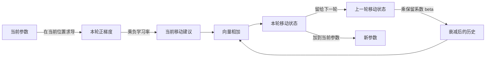
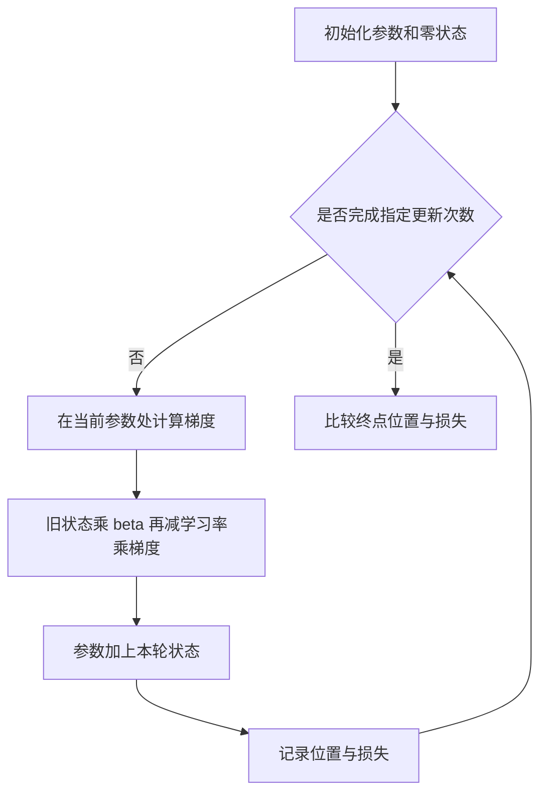

# Momentum：为什么更新参数时要参考之前的方向

> 适用范围：固定学习率的普通 Momentum。用二维二次函数解释更新机制，不涉及 Nesterov、权重衰减或真实模型性能评测。

**核心问题：** 如果每一步都朝局部下坡方向走，为什么还可能左右折返、前进缓慢？

**一句话答案：** Momentum 保存一个会衰减的移动状态，把它与当前调整相加；交替方向的贡献可能部分抵消，持续同向的贡献可以积累，但历史也可能让参数冲过头。

**阅读准备：** 参数是需要调整的数字；损失衡量当前预测与目标的差距；梯度给出局部上升最快的方向，负梯度给出局部下降方向。实践只需 Python 3，无第三方依赖。

## 1. 同样在下坡，为什么走法差很多

先不考虑庞大的网络，只让两个参数组成一个位置 $(x,y)$。设损失为：

$$L(x,y)=2x^2+0.1y^2.$$

最低点是 $(0,0)$，损失为零。横向的曲率比纵向大：稍微改变 $x$，损失就变化明显；同样幅度地改变 $y$，变化较缓。这是一条狭长山谷的简化模型。

我们从 $(1,-5)$ 出发，希望用尽量少的更新接近最低点。普通梯度下降只根据当前位置重新计算方向。学习率稍大时，横向可能越过中线，下一步又反向；与此同时，沿谷底的前进仍慢。减小学习率可能减少横跳，但所有分量的移动也一起缩小。

这里要学习的不是“所有震荡都必须使用动量”，而是一个更窄的问题：**能否利用前几步已经出现的趋势，改变下一步的方向和长度？**

## 2. 从约束推导出最少需要增加什么

普通梯度下降的更新写成：

$$g_t=\nabla L(\theta_{t-1}),\qquad a_t=-\eta g_t,\qquad \theta_t=\theta_{t-1}+a_t.$$

$\theta$ 是参数向量，$g_t$ 是本轮正梯度，$a_t$ 是本轮移动建议，$\eta$ 是学习率。它依赖当前位置，但没有单独保存此前的移动趋势。

如果要让历史参与决策，最少需要增加一个状态 $u$。历史不能永远等权保留，否则很久以前的方向也会持续强烈影响当前更新。因此每轮先乘一个保留系数 $\beta$，再加当前建议：

$$u_t=\beta u_{t-1}+a_t=\beta u_{t-1}-\eta g_t,$$
$$\theta_t=\theta_{t-1}+u_t.$$

这就是本文采用的 Momentum 表达。通常取 $0\leq\beta<1$，初始状态 $u_0=0$。它不是对噪声或正确答案的识别器，只是在所有分量上执行同一个递推。

这也不是唯一可能的优化办法。减小学习率、调整参数表示或使用其他优化器，都可能改变行为。Momentum 的特点是只添加一份递推状态，机制简单且可直接计算。

## 3. 两轮手算：同一个当前建议，结果如何改变

先用手选向量拆开加法。这两支向量不是上述二次函数连续运行的前两步。把图的右方叫 $x$ 正方向，上方叫“前进”，这里的上方不表示损失高度。

第一轮建议为 $(2,2)$。没有历史，所以移动 $(2,2)$，并保存 $u_1=(2,2)$。

第二轮建议为 $(-2,2)$，设 $\beta=0.5$：

| 步骤 | 运算 | 结果 |
|---|---|---|
| 保留历史 | $0.5(2,2)$ | $(1,1)$ |
| 加入当前建议 | $(1,1)+(-2,2)$ | $(-1,3)$ |
| 更新参数 | 当前位置 $(2,2)+(-1,3)$ | 新位置 $(1,5)$ |
| 保存状态 | 保存本轮合成移动 | $u_2=(-1,3)$ |

横向的“右一格”和“左两格”相抵后剩“左一格”；纵向的“上一格”和“上两格”同向，合成“上三格”。对比不使用历史时的 $(-2,2)$，方向也发生了变化，不只是统一放大。

如果把 $\beta$ 改成零，第二轮就恢复普通梯度下降的建议 $(-2,2)$。如果改成 $0.9$，结果是 $(-0.2,3.8)$。这些是这组手选输入的精确结果，不是通用加速比例。

## 4. 整体机制：输入、状态与输出



**图4-1｜一次 Momentum 更新的数据流。** 回边表示跨轮次保存，不表示同一轮无限计算。得到新参数后，下一轮在新位置重新计算梯度。

| 对象 | 职责 | 不代表什么 |
|---|---|---|
| 梯度 | 当前损失对参数的局部变化信息 | 全局最优路线 |
| 学习率 | 当前梯度转换成调整时的尺度 | 历史保留比例 |
| 动量状态 | 累积并衰减此前调整 | 模型知识或完整历史清单 |
| 新参数 | 应用合成移动后的取值 | 模型准确率一定提高 |

## 5. 连续运行时，每一步都要重算

回到 $L(x,y)=2x^2+0.1y^2$，梯度为 $(4x,0.2y)$。固定起点 $(1,-5)$、学习率 $0.4$、初始状态零。

第一轮两种方法都没有历史，因此：

$$g_1=(4,-1),\quad a_1=(-1.6,0.4),\quad \theta_1=(-0.6,-4.6).$$

第二轮的梯度必须在新位置算，不能继续使用旧梯度：

$$g_2=(-2.4,-0.92),\quad a_2=(0.96,0.368).$$

没有动量时，第二轮位置为 $(0.36,-4.232)$。有动量且 $\beta=0.5$ 时：

$$u_2=0.5(-1.6,0.4)+(0.96,0.368)=(0.16,0.568),$$
$$\theta_2=(-0.44,-4.032).$$

从这里开始，两种方法已经处在不同位置，下一轮的梯度也会不同。因此不能拿一串固定箭头喂给两种算法，再称为真实的连续优化对照。



**图5-1｜固定 20 次更新的教学实验。** 终止条件是次数，不是已经证明收敛；记录损失不会改变递推。

## 6. 一份状态为什么能包含更早的历史

把递推展开，且 $u_0=0$：

$$u_t=a_t+\beta a_{t-1}+\beta^2a_{t-2}+\cdots+\beta^{t-1}a_1.$$

每一步只需要上一轮的合成状态，上一轮已经包含更早的贡献。实现中无需保存越来越长的历史列表。

当 $\beta=0.5$ 时，一份旧贡献连续经过两轮保留，系数从 $1$ 变成 $1/2$、再变成 $1/4$。注意：这是**隔离某一份历史贡献**的变化；完整状态每轮还会加入新的调整，所以完整状态的长度不一定变小。

对有 $n$ 个参数的模型，普通 Momentum 额外维护对应的 $n$ 个状态元素，状态空间为 $O(n)$，每轮更新为 $O(n)$ 的逐元素乘加。这里只比较动量状态的增量，不意味着整个训练内存翻倍；激活、梯度、优化器实现与精度都会影响总内存。

也可保存梯度缓冲 $v_t=\beta v_{t-1}+g_t$，再用 $\theta_t=\theta_{t-1}-\eta v_t$。在固定学习率、零初值及相同普通动量约定下，令 $u_t=-\eta v_t$ 可得到本文表达。学习率随时间变化或采用其他状态初始化时，不能不加条件地照搬这个等价关系。

## 7. 用一个可运行实验核验

运行附件：[momentum_demo.py](examples/momentum_demo.py)。它只使用 Python 标准库，不下载模型、不联网。

```bash
python3 examples/momentum_demo.py
```

程序在每个算法各自到达的位置重算梯度，保存初始点与 20 次更新后的 21 条记录。固定函数、初值、学习率和更新次数，只改变动量系数。

| 方法 | 第20步的 $x$ | 第20步的 $y$ | 第20步损失 |
|---|---:|---:|---:|
| 普通梯度下降，$\beta=0$ | 0.00003656 | −0.94346665 | 0.089013 |
| Momentum，$\beta=0.5$ | −0.00060117 | −0.06284346 | 0.000396 |

表中数值为教学程序运行结果的舍入表示。这组条件下，Momentum 终点更接近最低点、损失更小。它没有测量神经网络的实际耗时、预测准确率或泛化能力。

成功判定不只是程序没有异常：向量手算结果应为 $(-1,3)$；两种方法初始记录相同；第 20 步动量损失小于无动量损失；$\beta=0.9$ 的反例存在损失回升。若结果不同，先查梯度是否每轮重算、位移是否加而不是再次减、旧状态是否只乘一次 $\beta$。

## 8. 为什么有效，也为什么会失效

### 收益与代价来自同一个状态

持续同向的调整会积累，来回交替的分量有机会相抵。但如果已经接近低处，历史仍然强烈指向旧方向，当前反向调整不足以抵消它，合成状态仍可能推动参数继续越过低处。

在同一二次函数中，将 $\beta$ 改为 $0.9$、保持其他设置不变，第 5 步损失约为 $0.072181$，第 6 步上升到约 $1.629663$。纵向坐标也从负侧跨到正侧，之后又能跨回来。这直接反驳了“动量保证每一步损失下降”的说法。

| 常见混淆 | 正确区分 |
|---|---|
| 动量就是把学习率调大 | 学习率缩放当前建议；历史向量相加还可能改变方向 |
| $\beta$ 越大就越快越稳 | 历史保留更久，也可能使转向更迟；需与学习率一起判断 |
| 状态里保存所有历史梯度 | 保存一份递推结果即可包含衰减后的历史贡献 |
| 动量会认出噪声和正确方向 | 它只做线性递推，不具备这样的语义判断 |
| 图线更直就是训练更好 | 至少要一起看参数、损失、训练稳定性和任务指标 |

小球惯性是直觉类比。真实算法不需要模拟小球材质、碰撞或重力，主要操作就是梯度计算、乘法与加法。

## 9. 换条件预测结果

1. 第二轮仍是 $(-2,2)$，旧状态 $(2,2)$，但 $\beta=0$，会怎样？
2. 某一份历史贡献经过三轮、每轮保留一半，还剩多少？完整状态也一定缩成这个比例吗？
3. 训练反复冲过谷底，应优先减小学习率还是降低动量系数？

**参考解答：**

1. 历史被清零，结果就是当前建议 $(-2,2)$。
2. 这份贡献剩 $1/8$。完整状态还包含新的调整，不能据此断言完整状态缩为 $1/8$。
3. 没有脱离任务的唯一答案。两者分别减少当前调整尺度或历史保留程度。保持其他条件，分别做受控比较，观察损失、震荡和任务指标；不能同时改多个参数后断言某一个是原因。动画或单次教学函数不能代替真实训练验证。

## 10. 技术速查

这条因果链是：当前位置的梯度只提供局部信息 → 引入可衰减状态 → 旧状态乘 $\beta$，加当前负梯度调整 → 用合成状态更新参数 → 反向可能抵消，同向可能积累 → 但仍可能过冲，并增加状态存储。

- **Batch Size** 影响本轮用哪些、多少样本估计梯度。
- **学习率** 控制梯度转换为调整时的尺度。
- **Momentum** 控制如何把历史趋势与当前调整结合。

三者作用在不同环节。理解 Momentum，最重要的是能跟踪一次状态递推，并知道它改变了什么、没有保证什么。
